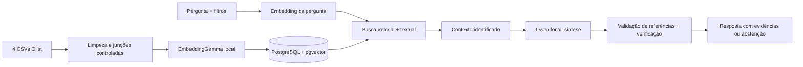

# Escuta — Voice of Customer Intelligence

Projeto da POSTECH, fase 4: investigar avaliações reais da Olist com RAG e evidências rastreáveis. IA e armazenamento executam localmente. O aplicativo cruza avaliações com pedidos, itens e categorias de produtos. Por padrão, a IA seleciona os relatos relevantes e o código apresenta os trechos originais como resposta extrativa. Isso evita exibir detalhes inventados em paráfrases; não garante que toda seleção seja relevante. A síntese livre (`RESPONSE_MODE=summary`) é experimental e exige revisão humana.

**Stack principal:** Python 3.12, FastAPI, PostgreSQL 16 + pgvector 0.8.6, Ollama, EmbeddingGemma 300M quantizado e Qwen2.5 3B. Há autenticação por token, limites de consultas, auditoria, métricas, backup e testes de integração. É uma implementação acadêmica com práticas operacionais; não implica homologação para produção.

## Como funciona



Cada avaliação válida é um documento. Compras com vários itens continuam tendo uma única avaliação, com uma lista de categorias do pedido. Os filtros de nota, compra, avaliação, situação, categoria e entrega atuam na busca no banco. A interface exibe o comentário original, IDs, datas e informações do pedido.

## Instalação recomendada: Python + banco em Docker

Pré-requisitos: Python 3.12, Docker com Compose e [Ollama](https://ollama.com/download). Reserve espaço para os modelos, dados e banco; a execução em CPU é suportada e pode levar dezenas de segundos por pergunta. Não há cobrança por tokens no modo local, mas há consumo de recursos da máquina.

```powershell
git clone https://github.com/leozoka0506/TECH4.git
cd TECH4
python -m venv .venv
.\.venv\Scripts\Activate.ps1
python -m pip install -r requirements-prod-lock.txt
python scripts/setup_env.py
docker compose up -d db
ollama pull embeddinggemma:300m-qat-q4_0
ollama pull qwen2.5:3b
python scripts/download_data.py
python -m escuta migrate
python -m escuta ingest
python -m escuta serve
```

No Linux/macOS, ative o ambiente com `source .venv/bin/activate`. O Ollama deve estar em execução na porta 11434. Abra **http://127.0.0.1:8501**, expanda “Acesso à aplicação” e informe o valor de `APP_TOKEN` do `.env`. O token fica somente na memória da página, sem armazenamento no navegador. Nunca envie o `.env` ao GitHub.

A primeira ingestão calcula embeddings do corpus inteiro e pode demorar. Ela confirma cada lote no banco e pode ser retomada repetindo o comando. A coleção anterior continua ativa até a nova terminar. Para uma demonstração menor, use `python -m escuta ingest --limit 2000`; a interface identifica explicitamente a amostra. Para voltar ao corpus completo, execute novamente sem `--limit`.

Se o Kaggle bloquear o download automatizado, obtenha o ZIP na [página oficial da Olist](https://www.kaggle.com/datasets/olistbr/brazilian-ecommerce) e coloque os seguintes arquivos em `data/raw/`:

- `olist_order_reviews_dataset.csv`
- `olist_orders_dataset.csv`
- `olist_order_items_dataset.csv`
- `olist_products_dataset.csv`

## Execução sem Docker no Windows

O PostgreSQL também pode ser instalado com pgvector ou usado de forma portátil. A instalação portátil utilizada na validação fica em `.runtime/postgres-env`, com um cluster exclusivo em `.runtime/postgres-data`. Não integra o repositório e não é um serviço do Windows.

Com [micromamba](https://mamba.readthedocs.io/en/latest/installation/micromamba-installation.html) disponível, em um caminho **sem acentos**:

```powershell
micromamba create -y -p .runtime/postgres-env -c conda-forge postgresql=16 pgvector=0.8.6
python scripts/setup_env.py
python scripts/local_postgres.py start
python -m escuta migrate
python -m escuta ingest
python -m escuta serve
```

Execute `setup_env.py` somente se ainda não houver `.env`; o script recusa sobrescrita. O script portátil escuta exclusivamente em `127.0.0.1:5433` e exige senha. `python scripts/local_postgres.py stop` encerra somente esse cluster. Nesta instalação já preparada, `iniciar.ps1` inicia os serviços portáteis presentes e a interface; mantenha o terminal aberto.

## Aplicação também em container

Após baixar dados e modelos e iniciar `db`:

```powershell
docker compose build app
docker compose run --rm app python -m escuta migrate
docker compose run --rm app python -m escuta ingest
docker compose up -d app
```

O Ollama continua no host. Para containers alcançá-lo, configure o endereço de escuta conforme a [documentação do Ollama](https://docs.ollama.com/faq) e restrinja o acesso no firewall; por padrão, ele escuta em loopback. A opção com Python no host dispensa essa alteração. O serviço `app` utiliza `host.docker.internal`, um usuário sem privilégios e filesystem somente leitura. O banco persiste no volume `postgres_data`; `docker compose down` preserva o volume. **Não use `down -v` se precisar preservar os dados.**

## Perguntas e filtros para demonstração

| Pergunta | Recorte sugerido | Resultado a investigar |
|---|---|---|
| O que os clientes relatam sobre atrasos na entrega? | Entrega atrasada | Relatos e comparação com datas do pedido |
| Quais elogios os clientes fazem aos produtos? | Notas 4–5 | Experiências positivas com referências |
| O que clientes insatisfeitos dizem sobre produtos quebrados? | Notas 1–2 | Comentários específicos sobre defeitos |
| O que os clientes dizem sobre os produtos? | Categoria cama_mesa_banho, compras em 2018 | Exploração contextual |
| Qual é a capital da França? | Sem filtros | Abstenção por ausência de evidência |
| O que os clientes disseram em 2030? | Compra a partir de 2030 | Nenhuma evidência no período |

As respostas reais e os tempos medidos ficam em `docs/evaluation_postgres.json`, gerado pelo avaliador. Perguntas sobre “mais frequente” ou “maioria” não autorizam transformar top-k em estatística da base: a aplicação apresenta relatos e explicita o alcance da seleção. Para estimar prevalência, seria necessário outro pipeline com rotulagem e agregação sobre o corpus.

## Testes e avaliação

```powershell
python -m pytest -q
python scripts/evaluate_professional.py
```

Os testes unitários usam dublês de IA e verificam preparação, referências, recusa, segurança da API e configurações. O teste PostgreSQL usa um schema aleatório, removido ao terminar, sem tocar na coleção ativa. Para executá-lo localmente, configure `TEST_DATABASE_URL` com a conexão de teste; a extensão `vector` deve existir. A CI provisiona PostgreSQL + pgvector e executa essa integração, além do build do container.

O avaliador consulta o banco e os modelos **reais**, grava nove casos de aceitação e verifica status, filtros e transcrições. Esses casos foram usados no desenvolvimento: não são um teste cego nem medem a acurácia geral do modelo. A fidelidade semântica e a relevância exigem revisão humana. Leia [validação e limitações](docs/VALIDACAO.md).

## Operação e documentação

- [Arquitetura, preparação e decisões](docs/ARQUITETURA.md)
- [Operação, backup, recuperação e futura nuvem](docs/OPERACAO.md)
- [Rastreio de todos os requisitos e adicionais](docs/REQUISITOS.md)
- [Roteiro de vídeo de até sete minutos](docs/ROTEIRO_VIDEO.md)
- [Continuação dos estudos](docs/ESTUDOS.md)

Estrutura principal: `escuta/` contém API, ingestão, banco e RAG; `web/`, a interface; `scripts/`, utilitários; `tests/`, verificações. `voice_customer/` preserva o protótipo NumPy e fornece funções reutilizadas de limpeza/cliente local/validação. `Aprendizado/` preserva os exercícios do aluno no repositório.

O projeto utiliza dados públicos históricos; respeite a licença da base e as licenças dos modelos. Dados, modelos, backups, senhas e ambientes virtuais não são versionados. O modo padrão não exige chave nem faz chamadas pagas. Um adaptador experimental de API permanece desativado e não foi validado com consumo pago.

**Entrega:** repositório [leozoka0506/TECH4](https://github.com/leozoka0506/TECH4). O vídeo precisa ser gravado e seu link incluído na entrega. O bônus de dez pontos da Databricks depende da conclusão da trilha pelo estudante e do respectivo comprovante; não é concedido por usar Databricks no código.
